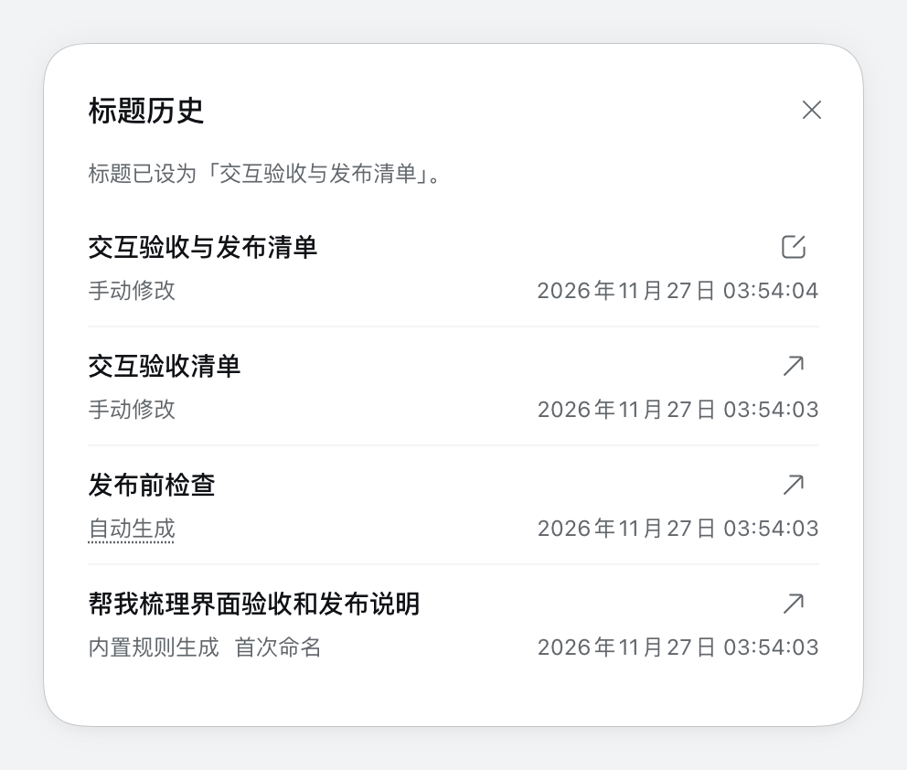

打开会话的 **⋯** 菜单，选择 **标题历史**。

点击当前标题旁的铅笔重命名会话。点击旧标题旁的 **↗** 将它设回当前标题。

对话中的 Agent 也可以用 `session_title_history` 工具查看、编辑或设回标题。

[查看使用指南](https://github.com/miorin-chan/dsh-session-title-history/blob/main/README.zh.md)
